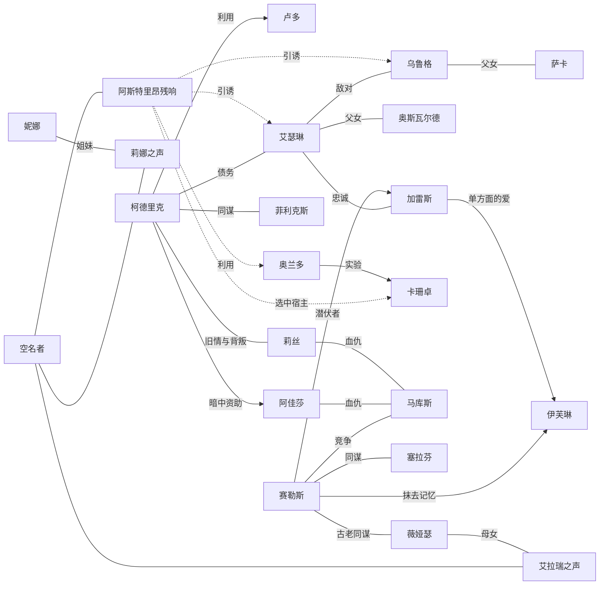

# 05｜人物档案与关系网

> 本文件规划所有具名人物：他们有多重要（量级）、是什么样的人（性格与特质）、想要什么、公开在做什么（明线）、暗中在做什么（暗线）、彼此是什么关系，以及玩家的一举一动怎样改变他们，进而改变故事走向。
> 势力层面的动向见 `04-势力与动向.md`；20 个发展方向的编号（D01–D20）见 `06-分支与结局走向.md`。

## 1. 人物量级

| 量级 | 含义 | 人数 | 主持规则 |
|---|---|---:|---|
| S 传奇 | 世界级存在，能改变整片大陆 | 2 | 不会在第三幕前完整现身；只能通过回声、梦、附身、代言人接触；不能被普通检定杀死 |
| A 领袖 | 势力的首领，决定一个势力的方向 | 8 | 每人都有“自主议程”，玩家不干预就会按时钟推进；死亡或失势会让所属势力进入动荡 |
| B 关键 | 某个地区或某条暗线的枢纽人物 | 12 | 是玩家最常打交道的人；可以被说服、收买、救下、背叛或失去 |
| C 地区 | 给某个地区带来面孔和情绪的人 | 16 | 有固定性格和一个小秘密；可以成为同行者 |
| D 路人 | AI 按需生成 | 不限 | 按第 9 节规则生成；被玩家反复互动后可以升为 C 级并写入存档 |

## 2. 人物状态与态度（规则）

**态度**：每个 S/A/B 级人物对队伍有一个态度值，−3 到 +3，初始值见各人档案。

| 值 | 含义 | 表现 |
|---:|---|---|
| +3 | 生死之交 | 会为队伍冒险、违背自己的势力、交出最重要的东西 |
| +2 | 盟友 | 主动提供情报、资源、庇护 |
| +1 | 友善 | 愿意交谈、交易，给予小帮助 |
| 0 | 中立 | 按利益行事 |
| −1 | 戒备 | 隐瞒、拖延、要价更高 |
| −2 | 敌对 | 设阻、通报、派人跟踪 |
| −3 | 死敌 | 主动追杀、陷害，或与队伍的敌人结盟 |

**状态**：活跃 / 受伤 / 被囚 / 失踪 / 遗忘病（轻·重） / 叛离原势力 / 被抹去（所有人都忘了他） / 死亡。状态变化必须由叙述中发生的事件引起，并写入存档。

**记忆**：每个 S/A/B 级人物的记忆分三部分，AI 在这个人物说话时必须参考：

- **近期印象**：最多记住队伍最近做过的 3 件事（一句话一件），新的挤掉最旧的。
- **刻骨记忆**：救命、背叛、亲人的死、当众受辱等重大事件，永久保留，不会被近期印象挤掉。
- **信念**：这个人物相信什么（例如“商会能救灰港”“守钟人在说谎”），以及让他相信的证据。信念只有在他亲眼看到或从可信的人那里得到新证据时才会改变；**好感不等于立场**——他可以喜欢队伍，同时继续反对队伍的做法。

**知情**：每个人物只知道他亲历、亲耳听到或通过传闻得知的事，并记下从谁那里、什么时候得知。没有知情记录的事，他不能在台词里提起；预写台词的“需知”（`09` 第 2.1 节）就是按这一条检查的。

**涟漪规则（一举一动如何扩散）**：

1. **直接影响**：玩家行动直接影响某人物时，该人物的态度 ±1（重大事件 ±2）。
2. **关系传导**：在第 7 节关系网中，与该人物有“忠诚/亲情/爱慕”关系的人物同向 ±1，有“敌对/竞争”关系的人物反向 ±1；只传导一层，不连锁。
3. **传闻延迟**：只有在场者立刻知道。不在场的人物要 1–3 轮后才通过传闻得知，并写入他的知情记录（传闻可能走样）；队伍能在传闻传到之前封口、改写或抢先解释。
4. **势力折算**：A 级人物的态度变化同时让其势力关系同向 ±1（每次事件最多 ±1）。
5. **方向推动**：每个人物档案的“推动方向”一栏列出这个人物的转变会给哪些发展方向加分（见 `06-分支与结局走向.md`）。

## 3. S 级：传奇

### 3.1 空名者

- **本质**：四百年来被回响之网吞下的所有记忆聚成的意识，不是一个人，而是一场合唱。说话时同时用很多人的声音，最常借用听者已故或遗忘的亲人的声音。
- **性格**：饥渴、天真、悲伤，像一个不断问“我是谁”的孩子；同时又带着帝国时代的傲慢。
- **想要**：被说出名字，从而真正存在。
- **害怕**：再一次沉默（被封印）、被撕碎（网被毁）。
- **明线**：第六声之后，它开始通过回声井、梦和遗忘病患者说话，向所有愿意听的人许诺：“说出我，我就把你们失去的还给你们。”
- **暗线（内部分裂）**：合唱里有三股力量在争夺主导——
  1. **阿斯特里昂的残响**：想借一个能承载回声的身体复生为皇帝（首选宿主是提夫林学生卡珊卓，或回响亲和高的玩家角色）。
  2. **安息的合唱**：以精灵少女艾拉瑞的声音为首，想被逐一说出名字，然后安息。
  3. **饥饿本身**：没有意志，只是网络“读取”的惯性。越被喂食越强。
  哪一股占上风，取决于玩家喂给它什么（记忆、名字、仪式），以及阿斯特里昂和艾拉瑞谁先被认出。
- **初始态度**：0（对所有人都一样渴望）。
- **自主议程**：时钟 3 起在回声井附近说话 → 时钟 6 让栖钟城的街区被记起又被忘掉（与守钟人的行动混在一起，难以分辨） → 时钟 9 万人同声 → 时钟 11 雾墙后退。
- **态度阶梯**：
  - 上升：倾听它、说出合唱中某个个体的名字、为它保存记忆、拒绝封印它。
  - 下降：试图封印、毁坏节点、利用它的声音牟利。
  - +3：它把一段被吞的记忆完整归还给队伍中的某人，并告诉队伍第七道门的真正位置。
  - −3：它在队伍到过的每个地方让人忘掉队伍。
- **推动方向**：D12 皇帝归来、D15 空名者获名、D19 万名安息、D17 第七声。

### 3.2 阿斯特里昂·卡莱斯特（末代皇帝的残响）

- **本质**：织音帝国末代皇帝。四百年前篡改第七钟，让网络收取活人的记忆以延续自己的意识，引发大遗忘。他的残响是空名者中最清醒、最有组织的一股声音。
- **性格**：优雅、耐心、极有说服力，真心相信自己是唯一能“让世界不再遗忘”的人。从不撒谎，只选择性地说真话。
- **特质**：说话时会先叫出对方名字；永远用“我们”而不是“我”；偶尔会以皇帝口吻发号施令，随后又道歉。
- **想要**：得到一具身体，重新统治一个“永不遗忘”的帝国。
- **害怕**：被认出（一旦被叫出真名“阿斯特里昂”，他就无法再藏在合唱后面）。
- **明线**：无。他不以自己的身份出现，而是伪装成“空名者的代言人”“一位温和的古代学者”“你遗忘的老师”。
- **暗线**：
  - 通过奥兰多院长的“人造钟心”实验接近卡珊卓。
  - 向乌鲁格许诺归还被第七钟吞下的兽人祖先之声，换取他打开烬钟城的大门。
  - 向艾瑟琳许诺治好她的遗忘病，换取冠钟城的钥匙。
- **初始态度**：+1（他想争取队伍）。
- **识破他的证据**（至少两处）：冠钟城的皇帝画像与回声里的说话方式一致；银叶长老薇娅瑟认得他的声音；栖钟城档案里的帝国诏书措辞；乌鲁格的史诗中“戴着钟冠的人”。
- **推动方向**：D12 皇帝归来（被帮助时），D15 / D19（被识破并与合唱分离时）。

## 4. A 级：势力领袖

### 4.1 柯德里克·瓦恩 —— 铜脉商会会长

- **身份**：人类，58 岁，灰港议会首席议员，大陆最富有的人之一。
- **外貌**：衣着朴素得刻意，戴一枚磨平了花纹的铜戒。
- **性格**：理性、慷慨、冷酷。他相信“一切都可以谈价钱，包括记忆”。
- **特质**：从不提高声音；喜欢先给对方倒酒；记得每个员工孩子的名字（这是他最可怕也最可爱的地方）。
- **想要**：让回响通讯成为大陆的血管，而商会是心脏。
- **害怕**：混乱。他见过灰港在饥荒年间的暴乱。
- **底线**：不亲手杀人（但会付钱让别人做）。
- **明线**：投资回响通讯，资助测绘队寻找白砾山脉的岩钟城遗址；在议会推动“回响物品登记令”。
- **暗线**：
  1. **私井**（暗线一）：灰港港湾下的帝国古回声井“潮井”被商会私下修复，由黑市拍卖师菲利克斯打理。商会用穷人的记忆（以“免费治疗”“抵债”为名收取）喂给空名者，换取市场预言。
  2. **资助拾名人**（暗线八）：通过三层中间人资助阿佳莎，用拾名人削弱王室和守钟人。
  3. **测绘队的真实任务**：妮娜的测绘队名义上是勘矿，实际是去找岩钟城的钟心。
- **关系**：卢多的上司（卢多崇敬他）；莉丝·雾帆的旧情人（他背叛了她）；艾瑟琳的债主（王室欠商会巨款）。
- **初始态度**：0。
- **自主议程**：时钟 1 登记令 → 时钟 4 回响通讯试运营 → 时钟 7 收购各地回声井 → 时钟 10 以“紧急状态”为名接管灰港议会。
- **态度阶梯**：
  - 上升：完成交易、带回钟心或测绘数据、保守商会秘密、解决灰港骚乱。
  - 下降：公开私井、与莉丝或拾名人结盟、毁掉商会资产。
  - +2：把队伍纳为“特别合伙人”，给予资金、船只、通行证。
  - −2：悬赏队伍，冻结他们在灰港的一切往来。
  - −3：雇莉丝的对头或守钟人追猎队对付队伍；把队伍的名字卖给私井。
- **关键转折点**：
  - 私井被揭露时，他会提出用一半商会利润“赎罪”换取沉默；接受与否决定 D03 与 D07 / D14 的走向。
  - 如果卢多当面质问他，他会说出真心话：“没有我，灰港早就饿死了一半。”
- **推动方向**：D03 商会之网；被揭露时推动 D07 拾名人起义、D14 修复之网。

### 4.2 艾瑟琳·卡尔维斯 —— 卡尔维斯摄政公主

- **身份**：人类，27 岁，国王奥斯瓦尔德四世的独女，代父摄政两年。
- **外貌**：总是穿着骑装上朝；左手腕上缠着一条写满小字的丝带。
- **性格**：果断、骄傲、孤独；把责任看得比自己重。
- **特质**：说话快，常常打断别人；会突然停下来看手腕上的丝带（那是她给自己写的提示，因为她也在遗忘）。
- **想要**：让王国在她忘掉一切之前稳住；让“断钟之夜”永不重演——哪怕要用王权统一诸国。
- **害怕**：在朝堂上认不出自己的大臣；变成她父亲那样。
- **底线**：不牺牲王国平民。
- **明线**：悬赏治愈遗忘病的人；整顿军备应对烬原部族。
- **暗线**：
  1. **公主的遗忘**（暗线二）：她自己已患轻度遗忘病，只有骑士团长加雷斯和王宫医者玛琳修女知道。
  2. **冠钟城计划**：她打算启用王都地下的冠钟城，把全国人的记忆“存”在王室掌控的网络里，以此对抗遗忘——这正是阿斯特里昂想要的。
- **关系**：加雷斯是她最信任的人；欠柯德里克巨款并厌恶他；视乌鲁格为最大外患；对守钟人既依赖又怀疑。
- **初始态度**：0。
- **自主议程**：时钟 2 父王失态事件 → 时钟 5 向烬原边境增兵 → 时钟 7 秘密启用冠钟城 → 时钟 10 以“治愈”为名征用各地回声井，或与烬原开战。
- **态度阶梯**：
  - 上升：带来治疗遗忘病的线索、保护她的秘密、在烬原问题上提供非战争选项、救下她父亲。
  - 下降：公开她的病、与烬原或拾名人站在一起时损害王权、揭发冠钟城计划。
  - +2：授予队伍王室特许状和骑士护送。
  - +3：把手腕上的丝带交给队伍中的某人——“如果我忘了，替我记得”。
  - −2：通缉队伍。
- **关键转折点**：
  - 阿斯特里昂向她许诺治愈。队伍是否在场、是否揭穿，决定她走向 D04 王冠之钟、D12 皇帝归来，还是 D11 诸族盟约。
  - 她的遗忘病若被公开，王国会出现继承危机（推动 D07）。
- **推动方向**：D04 王冠之钟、D11 诸族盟约；被欺骗时 D12。

### 4.3 赛勒斯 —— 守钟人大钟主

- **身份**：歌利亚，约 70 岁，守钟人教团的大钟主。“赛勒斯”是教团给他的名字；他已不记得自己出生时的名字。
- **外貌**：极高大，须发全白，脖子上挂着一枚从未敲响过的铜钟。
- **性格**：严厉、悲悯、疲惫；四百年的教团传统压在他一个人肩上。
- **特质**：说话前总先沉默三秒；从不直视别人眼睛，因为他怕记住太多人。
- **想要**：在自己死前完成“第二次封印”，让第七声永不响起。
- **害怕**：自己是错的——四百年的牺牲没有意义。
- **底线**：教团可以抹去记忆，但不杀无辜者（他的追猎队长马库斯不完全遵守这条）。
- **明线**：召集散落的守钟人，修复各地的静音结界。
- **暗线**：
  1. **守钟人的代价**（暗线三）：教团每隔几十年就抹去知情者的记忆来维持封印。第二次封印需要一整座城市的记忆作为“锁芯”——他选中了栖钟城。时钟 6 栖钟城街区消失，其实是守钟人的预演，不是空名者干的。
  2. **伊芙琳的老师**：他是伊芙琳·格雷和遗迹学者达维娜通信过的“那位老师”。他亲手给伊芙琳主持了抹去记忆的仪式。
- **关系**：加雷斯在骑士团的潜伏是他安排的；马库斯是他的刀；视薇娅瑟为四百年前的同谋者的继承人。
- **初始态度**：−1（他不信任任何知道太多的人）。
- **自主议程**：时钟 3 召集守钟人 → 时钟 6 栖钟城街区“预演” → 时钟 7 大抓捕 → 时钟 11 前往空名之城执行第二次封印。
- **态度阶梯**：
  - 上升：帮守钟人修复结界、保守教团秘密、找到第二次封印不用牺牲城市的方法。
  - 下降：公开教团抹忆的历史、救走被追猎的人、与空名者交谈。
  - +2：以大钟主身份为队伍引路进入空名之城（满足 R7 的替代条件）。
  - +3：在终局说出他想起来的真名，放下教团的职责。
  - −2：马库斯的追猎队开始追捕队伍。
- **关键转折点**：
  - 在栖钟城发现街区消失的真相时，队伍可以当面质问他。他会承认，并问：“那你们打算让谁来付这笔账？”
  - 他若死于终局前，教团分裂：马库斯走向极端（推动 D02、D05 的暗面），伊芙琳可能成为继任者（推动 D20）。
- **推动方向**：D05 再封印、D16 真相之日、D20 新守钟人。

### 4.4 奥兰多·维斯 —— 星图学院院长

- **身份**：侏儒，约 120 岁（侏儒中年），栖钟城星图学院院长，大陆最重要的回响学者。
- **外貌**：眼镜上有三层可以翻转的镜片；外套口袋里永远塞着写满公式的纸条。
- **性格**：热情、天才、善于自我说服；真心想治愈遗忘病，也真心享受“第一个看见真相”的感觉。
- **特质**：一兴奋就踮脚；把学生叫作“我亲爱的同事”；拒绝说“不可能”。
- **想要**：造出人造钟心，证明人类能驯服回响之网。
- **害怕**：妻子莫德彻底忘掉他（她患重度遗忘病，已经不记得他们结婚三十年）。
- **底线**：他认为自己有底线，其实没有——每一次越界都有“这次是为了救人”的理由。
- **明线**：公开讲座、出版研究、与各方合作研究遗忘病。
- **暗线**：
  1. **学院实验**（暗线九）：用提夫林学生做记忆共振实验，最出色的受试者是卡珊卓。
  2. **“古代学者”**：他的实验突破来自一位在回声里指导他的“古代学者”——这是阿斯特里昂。
- **关系**：曾是达维娜的导师；与塞拉芬议长互相利用；向柯德里克借钱；为艾瑟琳提供治疗方案。
- **初始态度**：+1（他喜欢一切有趣的人）。
- **自主议程**：时钟 4 发表“人造钟心”论文 → 时钟 8 在卡珊卓身上做完整实验 → 时钟 10 若阿斯特里昂未被识破，宿主仪式开始准备。
- **态度阶梯**：
  - 上升：带给他研究材料、与他讨论理论、帮助莫德。
  - 下降：阻止实验、带走卡珊卓、公开实验记录。
  - +2：给队伍学院通行权和实验室资源。
  - −2：向王室和商会举报队伍是“危险的回响携带者”。
- **关键转折点**：
  - 队伍若证明“古代学者”就是阿斯特里昂，他会崩溃，然后要么自首，要么疯狂地加快实验（取决于他对队伍的态度：≥ +1 自首，≤ 0 加速）。
- **推动方向**：D08 学院之火、D14 修复之网；被利用时 D12。

### 4.5 阿佳莎·洛文 —— 拾名人领袖

- **身份**：半身人，44 岁，拾名人运动的发起者。拾名人收集并公开被抹去者的名字。
- **外貌**：个子小、嗓门大，背着一个装满纸卷的背篓，每张纸上是一个被遗忘的人的名字。
- **性格**：热烈、固执、记仇；对受害者无比温柔，对加害者毫不留情。
- **特质**：每次见到新人都会问“有没有你想不起来的人？”；能唱出上千首遗忘前的歌谣。
- **想要**：让所有被抹去的人被重新记起，让抹去他们的人付出代价。
- **害怕**：自己也开始忘记弟弟的样子。
- **底线**：不伤害孩子。其他的，她越来越不确定。
- **明线**：在各城张贴“被遗忘者名单”，组织集会，掩护被守钟人追猎的人。
- **暗线**：
  1. **她的弟弟**：弟弟皮普在十二年前被守钟人抹去，整个村子都不记得他。这是她一切行动的起点。
  2. **资金来源**（暗线八）：运动的大笔资金来自柯德里克，她不知道。
  3. **激进派**：她的副手正在策划炸毁冠钟城入口，她知道并且犹豫。
- **关系**：恨赛勒斯和马库斯；与梅格（预制角色）可能有旧缘（梅格的石片上的名字在她的名单上）；对艾瑟琳抱有一丝同情（同为“正在失去的人”）。
- **初始态度**：+1。
- **自主议程**：时钟 2 名单张贴到王都 → 时钟 5 大集会 → 时钟 8 激进派行动（炸冠钟城入口） → 时钟 10 全面起义。
- **态度阶梯**：
  - 上升：帮她找回一个被抹去的名字、掩护被追猎者、揭露守钟人。
  - 下降：替守钟人或王室做事、阻止集会、出卖成员。
  - +2：拾名人网络为队伍提供藏身处和情报。
  - +3：把弟弟的名字交给队伍：“如果你们到了门前，替我说出他。”
  - −2：在名单上写下队伍成员的名字——作为“加害者”。
- **关键转折点**：
  - 资金真相被揭露时，她可能转而攻击商会（推动 D07 走向激烈），也可能用这笔钱的线索要挟柯德里克换取私井的关闭（推动 D14）。
- **推动方向**：D07 拾名人起义、D16 真相之日、D19 万名安息。

### 4.6 薇娅瑟·林歌 —— 银叶长老会首席

- **身份**：精灵，约 600 岁，银叶长老会首席长老。断钟之夜的亲历者之一。
- **外貌**：银发及地，双眼一只是绿色，一只褪成了灰白（那是她付出记忆的代价）。
- **性格**：安静、睿智、深怀愧疚；用沉默保护别人，也用沉默保护自己。
- **特质**：说话只用比喻，从不直接回答问题；在树下说话时声音会被树叶重复。
- **想要**：让精灵一族在这场风暴中幸存；在死前赎回一件事。
- **害怕**：誓言被打破，精灵们知道长老会四百年前做了什么。
- **底线**：不亲口说出断钟之夜的真相（誓言）——但她可以带人去看。
- **明线**：维持“不得言说”之誓，封闭林海边境，拒绝各方使者。
- **暗线**：
  1. **银叶之誓**（暗线五）：四百年前，长老会帮助守钟人掩盖了皇帝的罪行，并把精灵的古老记忆织进了网络作为封印的骨架。毁掉网络，精灵会失去全部的古老记忆。
  2. **她的女儿**：女儿艾拉瑞在断钟之夜被网络吞下。她能在叶钟城的树根里听见女儿的声音，那正是空名者中“安息的合唱”的领唱。
- **关系**：与赛勒斯的教团是旧同谋；认得阿斯特里昂的声音；年轻游侠艾尔文是她的侄孙，想打破沉默。
- **初始态度**：−1（不欢迎外人）。
- **自主议程**：时钟 4 封闭边境 → 时钟 7 长老会内部分裂（艾尔文一派要求公开） → 时钟 10 银叶全族退入古树，切断与外界联系。
- **态度阶梯**：
  - 上升：尊重誓言、帮助林海、给艾拉瑞的声音带去安慰。
  - 下降：强行闯入叶钟城、公开长老会的秘密、站在毁网一方。
  - +2：带队伍进入叶钟城，“让树替我说话”（可获得真相第三层）。
  - +3：为队伍打破誓言，代价是她失去自己的名字。
  - −3：长老会宣布队伍为“不可言说之人”，所有精灵拒绝与他们交谈。
- **关键转折点**：
  - 终局中若选择毁网，她会出现在门前请求：“至少让我先和女儿说一句话。”
- **推动方向**：D10 银叶归隐、D19 万名安息、D13 毁网（作为代价的承担者）。

### 4.7 乌鲁格·赤牙 —— 烬原大萨满

- **身份**：兽人，52 岁，烬原诸部的大萨满兼战酋。
- **外貌**：满身火山灰画成的纹路，一只耳朵上穿着七枚骨环，第七枚是空的。
- **性格**：豪迈、骄傲、记性极好；他的愤怒是四百年的。
- **特质**：说话像唱史诗；把每个陌生人都叫“客人”，直到对方证明自己是朋友或敌人。
- **想要**：收回烬钟城圣地；让帝国的继承者们承认烬原祖先被夺走的声音。
- **害怕**：族人在他死后忘了史诗。
- **底线**：不杀放下武器的人。
- **明线**：联合诸部向王国边境进军，要求归还烬钟城。
- **暗线**：
  1. **烬原史诗**（暗线六）：史诗记载，第七钟是用烬原祖先的声音铸成的——帝国用一千名兽人的“最后一句话”做了钟心的铸料。他是唯一能完整背诵这段史诗的人。
  2. **阿斯特里昂的许诺**：一个“戴着钟冠的声音”在烬钟城的熔岩里对他说话，许诺归还祖先之声。他半信半疑。
- **关系**：女儿萨卡主和，与他争执；视艾瑟琳为帝国的继承人；与赛勒斯有一份古老的、双方都不愿提起的休战约定。
- **初始态度**：0（“客人”）。
- **自主议程**：时钟 5 进军边境 → 时钟 7 与王国小规模交战 → 时钟 10 全面战争或签订和约（取决于王国和队伍） → 若与阿斯特里昂达成交易，时钟 11 打开烬钟城大门。
- **态度阶梯**：
  - 上升：倾听并记下史诗、在王国面前替烬原说话、在决斗或仪式中证明勇气、救下萨卡。
  - 下降：为王国作战、亵渎烬钟城、不尊重亡者。
  - +2：称队伍为“朋友”，派出向导与战士。
  - +3：把耳朵上空着的第七个骨环位置留给队伍中的某人——这是兽人最高的誓约。
  - −2：把队伍视为王国的走狗。
- **关键转折点**：
  - 真相第三层被公开时（第七钟铸料的真相），他会要求公开道歉与赔偿；王国的回应决定 D06 是和约还是战争。
- **推动方向**：D06 烬原清算、D11 诸族盟约；被欺骗时 D12。

### 4.8 莉丝·雾帆 —— 雾帆船团女王

- **身份**：提夫林，39 岁，沉默海群岛上最大的海盗船团首领。
- **外貌**：角上缠着航海用的铜丝；说话时海雾会在她身边变浓。
- **性格**：机敏、玩世不恭、内心极讲义气；最恨背叛。
- **特质**：用船的部件比喻一切；会给每个第一次见面的人起外号。
- **想要**：让沉默海成为谁也管不了的自由海。
- **害怕**：再被人利用一次。
- **底线**：不卖船员。
- **明线**：走私回响物品，劫掠商会船只，经营海上黑市。
- **暗线**：
  1. **守钟人学徒**：她年少时是守钟人秘港的学徒，因为“听得太清楚”被驱逐。她知道通往空名之城的海路。
  2. **旧情**：她曾是柯德里克的情人和合伙人，私井最初是他们一起发现的；他后来出卖了她的船队给王国海军。
  3. **雾钟城**：雾钟城的钟心就在她旗舰的龙骨里。
- **关系**：恨柯德里克又放不下；与马库斯有血仇；对卡珊卓这样的提夫林年轻人有天然的保护欲。
- **初始态度**：0。
- **自主议程**：时钟 3 劫掠商会船只 → 时钟 6 公开拍卖一枚“假钟心” → 时钟 8 幽灵船队出现，她决定是与之对抗还是利用它们 → 时钟 11 封锁通往空名之城的海路，向各方收取“过路费”。
- **态度阶梯**：
  - 上升：守信、对付商会、救出被俘的船员、带来马库斯的消息。
  - 下降：为商会运货、出卖船团、对提夫林有偏见。
  - +2：带队伍走秘密海路去空名之城。
  - +3：把龙骨里的钟心交给队伍。
  - −2：悬赏队伍的人头，海路全部关闭。
- **推动方向**：D09 雾海自由港、D17 第七声（通过海路与钟心）、D03 的反面。

## 5. B 级：关键人物

> 格式缩短：身份 / 性格与特质 / 明线 / 暗线 / 初始态度 / 关键转折与推动方向。

### 5.1 卢多·费恩 —— 铜脉商会代理人
- **身份**：人类，41 岁，商会在灰港与白砾山脉的代理人。开场时招募队伍。
- **性格与特质**：精明、焦虑、本质上是个好人；说话时总在擦一枚商会徽章。
- **明线**：雇队伍找回失联的测绘队，开价很高。
- **暗线**：母亲患重度遗忘病，柯德里克许诺“商会的新技术”能治好她，这是他死心塌地的原因。他不知道私井用的是穷人的记忆——包括他母亲被“免费治疗”时交出的那部分。
- **初始态度**：+1。
- **关键转折**：得知私井真相（需证据）时，他会经历三步：否认 → 去潮井亲眼看 → 决定。态度 ≥ +2 时他会站到队伍一边，成为揭露柯德里克的关键证人；态度 ≤ 0 时他会选择沉默并要求更高的报酬。推动 D03 或 D14 / D07。

### 5.2 伊芙琳·格雷 —— 叛离的守钟人
- **身份**：人类，46 岁，白砾山脉回声井的守井者。十八年前离开教团。
- **性格与特质**：冷静、孤僻、极度可靠；每天在本子上写下“今天我记得的事”。
- **明线**：守住回声井，阻止任何人打开第七道门的回声。
- **暗线**（暗线四）：她当年为封井自愿抹去了一段记忆——她忘掉的是她的搭档加雷斯。加雷斯记得她，她不记得他。
- **初始态度**：0。
- **关键转折**：若队伍带加雷斯来见她，或拿出加雷斯保存的信物，她会面对“一个爱过她、她却不认识的人”。若赛勒斯死去或失势，她是最可能的继任大钟主。推动 D05、D20、D16。

### 5.3 妮娜·瑞斯 —— 测绘队长
- **身份**：人类，34 岁，失联测绘队的队长，开场时下落不明。
- **性格与特质**：坚韧、务实，对危险有一种近乎失礼的直接。受困后开始用妹妹的口头禅说话。
- **明线**：带队勘测岩钟城遗址，因听见妹妹的声音而深入。
- **暗线**：她的妹妹莉娜五年前死于矿难，莉娜的记忆在网里，是“安息的合唱”中的一员。空名者通过妮娜向外界说话；妮娜越久留在井边，越像一个传声筒。
- **初始态度**：0（被救出后通常 +2）。
- **关键转折**：救出她（白砾核心冒险）是第一个大抉择。她可能成为空名者与人世间的“翻译”，推动 D15 / D19。若她被留下，她会在时钟 9 成为“万人同声”的领唱。

### 5.4 加雷斯·铁誓 —— 卡尔维斯骑士团长
- **身份**：人类，50 岁，王国骑士团长、公主的护卫。
- **性格与特质**：沉稳、忠诚、话少；口袋里总揣着一张折叠了很多次的旧纸条（是伊芙琳十八年前写给他的）。
- **明线**：守护公主、整军备战。
- **暗线**（暗线四）：他是赛勒斯安插在王室的守钟人潜伏者，向教团报告冠钟城的情况。他也是伊芙琳被抹去的那段记忆的主人公。
- **初始态度**：0。
- **关键转折**：当赛勒斯命令他阻止公主启用冠钟城时，他要在公主和教团之间二选一。队伍对两边的影响决定他的选择。他的选择会让 D04 或 D05 加分。

### 5.5 塞拉芬·凯恩 —— 栖钟议长
- **身份**：人类，60 岁，栖钟城议会议长。
- **性格与特质**：圆滑、爱民、怕事；习惯用“我们讨论一下”拖延所有决定。
- **明线**：维持栖钟城的秩序，安抚街区消失引发的恐慌。
- **暗线**：他和赛勒斯有密约：守钟人保证栖钟城的“大多数”安全，他配合守钟人进行“预演”。他以为只会牺牲一条街。
- **初始态度**：0。
- **关键转折**：知道真相的队伍可以逼他公开密约（推动 D16），或帮他找到保全全城的办法（推动 D05 的温和版本、D14）。

### 5.6 罗兰·凯斯 —— 栖钟城织机档案师
- **身份**：人类，36 岁，管理栖钟城地下的记忆织机档案。
- **性格与特质**：一丝不苟、社交笨拙；会背诵档案编号却记不住同事的名字。
- **明线**：维护档案、协助议会登记失踪者。
- **暗线**：他发现档案在被人“删改”（守钟人的预演痕迹），他把原件藏了起来，不知道该交给谁。
- **初始态度**：0。
- **关键转折**：他手里的原件是真相第三层的关键证据之一。交给拾名人、学院、议会还是守钟人，每个选择推动不同方向（D07 / D08 / D16 / D05）。

### 5.7 博林·铁砧 —— 白砾矿镇镇长
- **身份**：矮人，140 岁，白砾矿镇镇长，岩钟城古道的世袭看守。
- **性格与特质**：豪爽、迷信、顽固；每句话都以矮人谚语开头。
- **明线**：保护矿镇，反对商会把回声井“挖穿”。
- **暗线**：矮人祖先修筑回声井时与帝国签过一份契约，承诺“井会还回借出的东西”。契约原件在他家族的铁箱里，是“修复之网”方向的关键依据。
- **初始态度**：+1。
- **关键转折**：交出契约意味着矮人承认参与过帝国工程。推动 D14 修复之网、D11。

### 5.8 卡珊卓 —— 星图学院学生
- **身份**：提夫林，19 岁，学院最有天赋的学生，奥兰多院长的实验受试者。
- **性格与特质**：聪明、渴望被认可、对自己的回响能力既骄傲又害怕；会在梦里说出不属于自己的语言。
- **明线**：在学院读书，协助院长研究。
- **暗线**：她是阿斯特里昂选中的宿主。她梦里的语言是帝国宫廷语。
- **初始态度**：0。
- **关键转折**：带走她、保护她或让她自己选择，是 D12 皇帝归来能否发生的关键。如果她在知情后自愿成为“容器”去承载安息的合唱而不是皇帝，会推动 D19。

### 5.9 萨卡·赤牙 —— 乌鲁格之女
- **身份**：兽人，24 岁，烬原年轻一代的领袖。
- **性格与特质**：机智、务实、敢于顶撞父亲；喜欢学别国语言，常把俗语用错。
- **明线**：主张与王国谈判。
- **暗线**：她已经秘密与王国边境的一位骑士（加雷斯的部下）通信，筹划停战。若被父亲发现，是叛族之罪。
- **初始态度**：+1。
- **关键转折**：她的密信若被截获，烬原与王国的和谈会破裂。推动 D06 的和约版本、D11。

### 5.10 菲利克斯“银舌” —— 灰港黑市拍卖师
- **身份**：人类，45 岁，灰港最有名的黑市拍卖师，实际打理商会私井。
- **性格与特质**：风趣、贪婪、胆小；说话像在叫价，每句话都带数字。
- **明线**：拍卖回响物品。
- **暗线**（暗线一）：私井的日常操作者；他留着一本“记忆账本”，记录了每一个被收取记忆的人。
- **初始态度**：0。
- **关键转折**：他的账本是揭露私井的最硬证据。他会卖给出价最高的人——包括莉丝、阿佳莎和守钟人。

### 5.11 奥斯瓦尔德四世 —— 卡尔维斯老国王
- **身份**：人类，71 岁，重度遗忘病患者。
- **性格与特质**：时而孩子气，时而突然清醒、威严；清醒时会说出四十年前的宫廷秘密。
- **明线**：被藏在王宫深处。
- **暗线**：他年轻时进过冠钟城，在那里“听见过皇帝”，他的遗忘病是从那时开始的。他清醒时的只言片语是真相第三、四层的证据。
- **初始态度**：+1（他把所有人都当成老朋友）。
- **关键转折**：治好他（哪怕暂时）或让他在朝堂上说出真相，会动摇艾瑟琳的冠钟城计划。

### 5.12 马库斯·霜钟 —— 守钟人追猎队长
- **身份**：人类，40 岁，守钟人追猎队长。
- **性格与特质**：虔诚、冷酷、有洁癖；抹去别人的记忆前会先为对方祈祷。
- **明线**：追捕“知道太多的人”。
- **暗线**：十二年前抹去阿佳莎弟弟的人就是他；他私下认为赛勒斯太软弱，准备在必要时夺权。
- **初始态度**：−1。
- **关键转折**：他是唯一可能“主动带来坏结局”的 B 级人物：若赛勒斯失势而他掌权，D02 大遗忘重演和 D05 的残酷版本加分。

## 6. C 级：地区人物

| 姓名 | 种族 / 身份 | 地区 | 性格（一句话） | 小秘密 | 可成为同行者 |
|---|---|---|---|---|---|
| 乔安·梅尔 | 人类，测绘员 | 白砾 | 勇敢但怕黑，总在数数 | 忘了自己的姓，“梅尔”其实是守钟人家族的姓 | 是 |
| 艾伯·科尔 | 人类，测绘员 | 白砾 | 话多，爱吹牛 | 偷偷把测绘图卖给过莉丝的人 | 是 |
| 凯蒂·伍德 | 半身人，测绘员 | 白砾 | 胆小、细心 | 能用歌谣记住整条地道 | 是 |
| 老温斯顿 | 人类，退休矿工 | 白砾 | 酒鬼、预言家 | 年轻时在井边听见过“第七声” | 否 |
| 内德 | 人类，矿工 | 白砾 | 原本沉默，现在用亡者的声音说话 | 是哈兰（预制角色）在塌方里丢下的同伴 | 否 |
| 罗莎 | 人类，七灯酒馆老板娘 | 灰港 | 精明、热心、什么都知道一点 | 酒馆地窖通向潮井 | 否 |
| 提姆·小丘 | 半身人，吟游诗人 | 流动 | 快乐、八卦 | 是阿佳莎的情报员 | 是 |
| 托马斯 | 人类，守钟人信使 | 灰港（开场） | 年轻、惊恐 | 他带的静音晶体是赛勒斯第二次封印的一部分 | 视开场而定 |
| 艾尔文 | 精灵，游侠 | 银叶 | 急躁、理想主义 | 想打破长老会的沉默，与拾名人有联系 | 是 |
| 汉娜 | 人类，面包师 | 栖钟 | 坚强、固执 | 是唯一记得消失街区的人，因为她那晚在河底 | 是 |
| 伊娃·齿轮 | 侏儒，钟匠 | 栖钟 | 唠叨、心软 | 基兰（预制角色）的师父；为学院修过“不该修的钟” | 否 |
| 达格 | 兽人，年轻战士 | 烬原 | 热血、想证明自己 | 偷偷崇拜王国骑士 | 是 |
| 格里姆船长 | 幽灵船上的回声 | 沉默海 | 庄重、悲凉 | 四百年前帝国舰队的船长，知道雾钟城的位置 | 否 |
| 玛琳修女 | 人类，王宫医者 | 卡尔维斯 | 温柔、坚定 | 知道公主的病；是芙蕾雅（预制角色）的老师 | 否 |
| 法比安 | 人类，商会会计 | 灰港 | 胆怯、正直 | 发现了私井的账目异常，准备匿名告发 | 否 |
| 莫德·维斯 | 侏儒，院长之妻 | 栖钟 | 不记得任何人，但记得每一首歌 | 她的歌里藏着奥兰多三十年前的研究笔记 | 否 |

## 7. 关系网

### 7.1 关系类型

忠诚 / 亲情 / 爱慕 / 师徒 / 同谋 / 债务 / 利用 / 竞争 / 敌对 / 血仇。涟漪规则中，“忠诚、亲情、爱慕、师徒”按同向传导，“竞争、敌对、血仇”按反向传导，“同谋、债务、利用”不传导但会在揭露时引爆。

### 7.2 关系总表

| 人物 A | 人物 B | 公开关系 | 真实关系 | 引爆条件与后果 |
|---|---|---|---|---|
| 柯德里克 | 卢多 | 上司与心腹 | 利用（卢多母亲的记忆被私井收取） | 卢多得知真相 → 卢多倒戈或沉默 |
| 柯德里克 | 莉丝 | 商会与海盗，死对头 | 旧情人、旧合伙人、背叛 | 两人同场 → 可能和解、交易或火拼 |
| 柯德里克 | 阿佳莎 | 互不相识 | 暗中资助（利用） | 资金真相揭露 → 阿佳莎转攻商会 |
| 柯德里克 | 艾瑟琳 | 王室与债主 | 债务、互相厌恶 | 商会催债 → 王室被迫让步或翻脸 |
| 柯德里克 | 菲利克斯 | 互不承认认识 | 同谋（私井） | 菲利克斯被抓 → 账本流出 |
| 艾瑟琳 | 加雷斯 | 公主与骑士团长 | 忠诚（他也是守钟人潜伏者） | 教团命令他阻止公主 → 二选一 |
| 艾瑟琳 | 奥斯瓦尔德 | 父女 | 亲情；他是她的恐惧 | 国王当众说出真相 → 冠钟城计划动摇 |
| 艾瑟琳 | 乌鲁格 | 王国与外敌 | 敌对；她是他眼中的帝国继承人 | 真相第三层公开 → 道歉或开战 |
| 艾瑟琳 | 阿斯特里昂 | 无 | 被引诱（许诺治愈） | 她接受 → D12 加分；被揭穿 → D11 加分 |
| 赛勒斯 | 伊芙琳 | 已断绝的师徒 | 他亲手抹去了她的记忆 | 伊芙琳得知 → 对质；她可能继任或彻底决裂 |
| 赛勒斯 | 加雷斯 | 无公开关系 | 上级与潜伏者 | 加雷斯暴露 → 王室驱逐守钟人 |
| 赛勒斯 | 马库斯 | 大钟主与追猎队长 | 竞争（马库斯想夺权） | 赛勒斯失势或死亡 → 马库斯掌权 |
| 赛勒斯 | 塞拉芬 | 无公开关系 | 同谋（栖钟城预演） | 密约公开 → 栖钟城暴乱 |
| 赛勒斯 | 薇娅瑟 | 古老的盟友 | 同谋（断钟之夜掩盖） | 任一人打破沉默 → 另一人被迫表态 |
| 赛勒斯 | 乌鲁格 | 互不往来 | 古老的休战约定 | 约定被撕毁 → 烬原进入守钟人领地 |
| 伊芙琳 | 加雷斯 | 她不认识他 | 爱慕（他单方面记得） | 两人重逢 → 情感高潮；可能找回记忆（代价自定） |
| 奥兰多 | 卡珊卓 | 院长与学生 | 利用（实验受试者） | 实验曝光 → 卡珊卓出走或被带走 |
| 奥兰多 | 阿斯特里昂 | 他以为是“古代学者” | 被利用 | 被揭穿 → 奥兰多自首或加速 |
| 奥兰多 | 达维娜（预制） | 前导师 | 师徒，有旧怨 | 见面 → 达维娜可获得学院内部信息 |
| 奥兰多 | 莫德 | 夫妻 | 亲情；他一切越界的理由 | 莫德的歌被解读 → 实验笔记曝光 |
| 阿佳莎 | 马库斯 | 拾名人与追猎者 | 血仇（他抹去了她弟弟） | 两人相遇 → 必有一方倒下，除非队伍介入 |
| 阿佳莎 | 提姆 | 朋友 | 她的情报员 | 提姆被捕 → 拾名人网络暴露 |
| 薇娅瑟 | 艾拉瑞 | 母女 | 亲情；女儿在空名者中 | 队伍带来女儿的声音 → 薇娅瑟态度 +2 |
| 薇娅瑟 | 艾尔文 | 长老与侄孙 | 竞争（守密 vs 公开） | 艾尔文出走 → 长老会分裂 |
| 薇娅瑟 | 阿斯特里昂 | 无 | 她认得他的声音 | 她在场时他无法伪装 |
| 乌鲁格 | 萨卡 | 父女 | 亲情与竞争（战 vs 和） | 密信被截获 → 萨卡被囚或出走 |
| 乌鲁格 | 阿斯特里昂 | 无 | 被引诱（归还祖先之声） | 他接受 → 时钟 11 烬钟城开门 |
| 莉丝 | 马库斯 | 海盗与追猎者 | 血仇 | 马库斯出海 → 海战 |
| 莉丝 | 卡珊卓 | 无 | 莉丝对提夫林年轻人有保护欲 | 卡珊卓有危险 → 莉丝可被说服出手 |
| 妮娜 | 莉娜 | 姐妹 | 亲情；妹妹在空名者中 | 妮娜留在井边 → 成为传声筒 |
| 卢多 | 洛森（预制） | 雇主与旧雇员 | 债务与愧疚 | 卢多向洛森道歉 → 洛森的钩子解开 |

### 7.3 关系图（概览）

## 8. 暗线总表

每条暗线都有“如果没人揭开会怎样”：暗线不会因为玩家没去碰就消失，而是按时钟自己爆开，只是以最糟的方式。

| 编号 | 暗线 | 涉及人物 | 揭开所需证据（任取两条） | 揭开后 | 无人揭开时（按时钟） |
|---|---|---|---|---|---|
| 一 | 商会的私井 | 柯德里克、菲利克斯、卢多 | 菲利克斯的账本；法比安的匿名信；罗莎酒馆地窖的通道；卢多母亲的病历；莉丝的证词 | 灰港议会危机，D03 受挫，D07 / D14 加分 | 时钟 7 商会收购各地回声井，D03 大幅加分 |
| 二 | 公主的遗忘 | 艾瑟琳、加雷斯、玛琳 | 手腕丝带；玛琳的诊疗记录；加雷斯的口风；公主在朝堂上叫错名字 | 王位继承危机；艾瑟琳可能更依赖或更抗拒队伍 | 时钟 7 冠钟城秘密启用，D04 / D12 加分 |
| 三 | 守钟人的代价 | 赛勒斯、塞拉芬、马库斯 | 罗兰藏起的档案原件；汉娜的证词；塞拉芬的密约；托马斯的静音晶体 | 守钟人信誉崩塌，D16 加分；第二次封印需要新的代价 | 时钟 11 赛勒斯执行第二次封印，栖钟城失去名字，D05 加分 |
| 四 | 伊芙琳与加雷斯 | 伊芙琳、加雷斯、赛勒斯 | 加雷斯的旧纸条；伊芙琳本子上反复出现又被划掉的字母“G”；赛勒斯的承认 | 两人重逢；伊芙琳可能离开或接掌教团 | 加雷斯在王室与教团冲突中战死，伊芙琳永远不知道 |
| 五 | 银叶之誓 | 薇娅瑟、艾尔文、赛勒斯 | 叶钟城树根中的记忆；艾尔文偷出的长老会卷轴；赛勒斯的承认 | 精灵族内部分裂；“毁网”的代价被所有人知道 | 时钟 10 银叶归隐，D10 加分 |
| 六 | 烬原史诗 | 乌鲁格、萨卡、赛勒斯 | 乌鲁格的完整史诗；冠钟城的铸钟记录；格里姆船长的回忆 | 帝国罪行被承认的可能；D06 / D11 走向和约 | 时钟 10 全面战争，D06 走向战争版本 |
| 七 | 空名者的分裂 | 阿斯特里昂、艾拉瑞、莉娜、卡珊卓 | 薇娅瑟认出声音；妮娜转述的合唱；卡珊卓梦中的宫廷语；冠钟城画像 | 队伍能分辨“和谁谈判” | 阿斯特里昂主导合唱，时钟 11 后 D12 大幅加分 |
| 八 | 拾名人的资金 | 柯德里克、阿佳莎、提姆 | 中间人的汇票；提姆的调查；菲利克斯的账本 | 阿佳莎转攻商会或要挟商会 | 阿佳莎在激进派行动后被商会切断资金并出卖 |
| 九 | 学院实验 | 奥兰多、卡珊卓、莫德、伊娃 | 实验记录；卡珊卓的伤痕；莫德歌里的笔记；伊娃修过的“不该修的钟” | 学院关闭或改革；卡珊卓的命运由她自己选择 | 时钟 10 宿主仪式准备完成 |

## 9. D 级路人的生成规则

- 名字遵循 `01-世界观圣经.md` 第 2 节的命名规范，按种族与地区取名，不与具名人物重名。
- 每个路人给出：一个外貌细节、一种说话方式、一个当下的需要。
- 路人不能知道真相第三层以上的内容；可以知道传闻（真假混杂，AI 需标记为传闻）。
- 玩家与同一个路人互动 3 次以上，或路人在重要事件中出力，AI 可以把他升为 C 级：补一个小秘密，写入存档。

## 10. 预制角色与世界的联结

预制角色保留原 id，便于将来程序迁移；名字改为西方风格。

| id | 新名 | 身份 | 动机 | 钩子（与核心人物的关系） | 纪念物（新解释） |
|---|---|---|---|---|---|
| helan | 哈兰 | 前矿工 | 证明旧事故不是自己造成的 | 曾在塌方中丢下同伴内德，内德如今用亡者的声音说话；博林镇长知道当年的真相 | 一枚无主工牌——属于内德 |
| fuhe | 芙蕾雅 | 巡回医者 | 找到一位失踪病患 | 曾救过乔安，但乔安不记得她；王宫医者玛琳是她的老师 | 一封未寄出的信——写给玛琳，信里提到公主的病 |
| qilan | 基兰 | 钟匠学徒 | 听懂一段从童年起反复出现的旋律 | 师父是栖钟城钟匠伊娃；相信伊芙琳说的部分真相；那段旋律是第七声的片段 | 失灵但仍上弦的怀表——每逢回声井附近就会走动 |
| luocen | 洛森 | 边境向导 | 拿钱带家人离开矿区 | 受卢多雇佣过，不想再替商会冒险；家人住在白砾矿镇 | 缺了一齿的铜钥匙——商会私井大门钥匙的一部分 |
| meijia | 梅格 | 流动说书人 | 寻找一段被自己遗忘的故事 | 曾把某位同伴的秘密写进故事，尚未承认；她自己五年前被马库斯抹去过记忆 | 写有陌生名字的石片——那是她原本的名字，也在阿佳莎的名单上 |
| dawei | 达维娜 | 遗迹学者 | 让古代记忆库不落入商会手中 | 与伊芙琳的老师（赛勒斯）有过书信往来；曾是奥兰多院长的学生 | 亲友留下的布片——栖钟城消失街区的旗帜碎片 |

**自建角色**：车卡时由 AI 从“与核心人物的关系”中抽取一条钩子，挂到一位 B 级或 C 级人物身上，并写入该人物的印象。

## 11. 旧名对照（第一章原模组 → 新世界）

| 旧名 | 新名 | 说明 |
|---|---|---|
| 陆铎 | 卢多·费恩 | 公会代理人 → 铜脉商会代理人 |
| 宁芮 | 妮娜·瑞斯 | 测绘队长 |
| 乔安 | 乔安·梅尔 | 测绘员 |
| 伊芙琳 | 伊芙琳·格雷 | 守井者 → 叛离的守钟人 |
| 回声仿兽 | 回声仿兽（保留） | 回声井附近的怪物，由被吞记忆的碎片凝成 |
| 赫岚 / 芙禾 / 祁岚 / 洛岑 / 梅迦 / 达薇 | 哈兰 / 芙蕾雅 / 基兰 / 洛森 / 梅格 / 达维娜 | 预制角色 |
| 岑遥 / 罗缄 / 阿织（第二章素材） | 塞拉芬·凯恩 / 罗兰·凯斯 / 阿佳莎·洛文 | 第二章素材中的人物并入新世界 |
