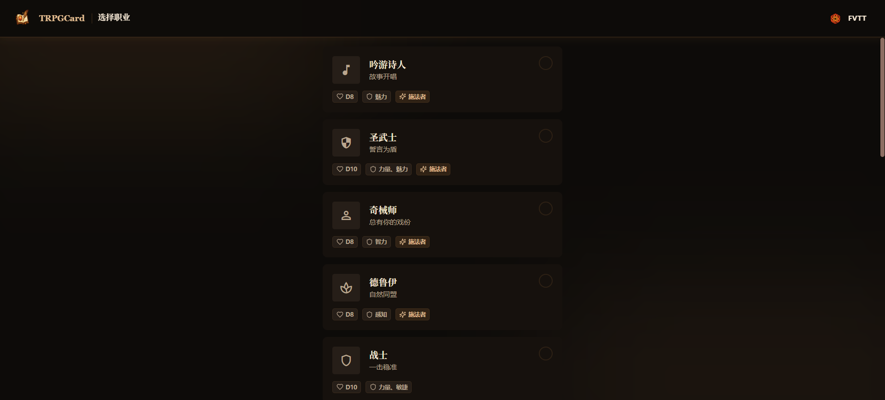
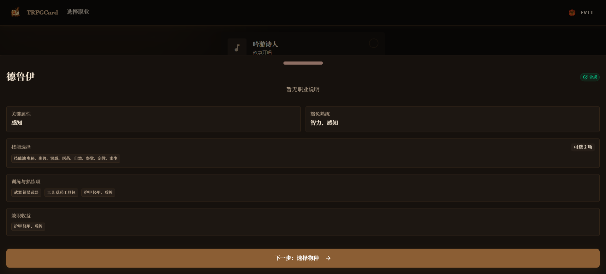
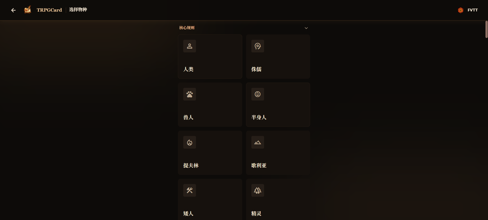

# 用户需求与参考

来源：本次聊天中用户对《回声井》试玩的反馈及后续确认。用来恢复项目目标，不替代源码、测试和当天验收记录。

## 原始五类问题

1. 阅读：AI 连续行动时文字跳到最底部，迫使玩家向上找前文。需要未读定位、更舒适的文字区域和语音朗读。
2. 视觉：右侧资料栏使用较少，希望突出当前行动人物，通过形象和状态提高视觉乐趣。
3. 剧情：连续性和主持引导不足，约10分钟结束；开场设定、角色道具用途不明确。入团理由和关系希望自动生成，并作为后续剧情的伏笔。
4. 车卡：提供多种职业、种族、属性与技能选择，形成有实际作用的角色设定，而不只填写人物标签。
5. 联机：先创建/加入房间，再由玩家选择或创建角色。

## 后续明确要求

- 车卡还要有完整随机生成，让不想定制的玩家直接开始；也允许随机后微调。
- Codex 负责调度和严格复核，WorkBuddy 执行；专业 agent 的真实可用性和模型费用需核验，不能虚构。
- 免费 Hy4 优先，也允许核对过的低积分模型，不必限制为完全免费。
- 云电脑因费用取消，继续本地执行。
- 所有可复现的代码、设计、接入方法、需求资料和任务检查点保存在 GitHub，使换电脑或新聊天能接续。认证缓存和机器会话状态保留本地。
- 每次更新写入 `修改日志/YY-MM-DD.md`；每天开始修改先读全部过往日志，README 明确要求。

## 用户提供的车卡参考截图

以下截图用于理解职业列表、详情和种族选择的交互；不是本项目已实现画面，也不作为游戏美术资产或第三方规则授权。

当前项目采用 2d6 四属性规则；参考图中的其他规则体系不能只搬界面标签后宣称已实现。具体进度见根目录 CONTINUE.md 和任务 JSON。
